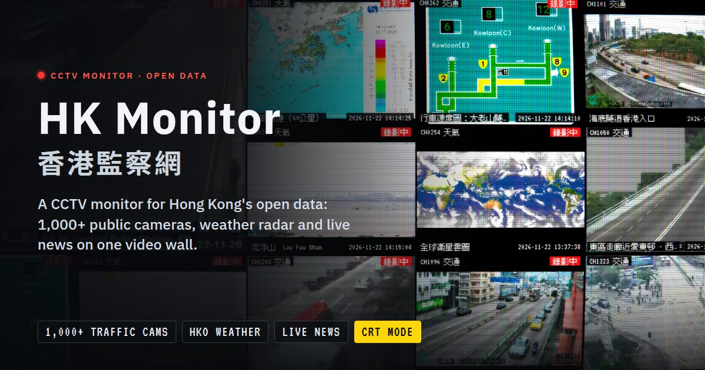

# HK Monitor · 香港監察網

**English** · [繁體中文](#香港監察網--hk-monitor)



**Live:** https://hk-monitor.wiiiimm.codes

**A CCTV monitor for Hong Kong — channel-surf the city like a security control room.** 1,000+ public traffic cameras
with the live road speed and local weather burned into the picture, Observatory weather cameras and radar, Himawari
satellite views, live news and Hong Kong YouTube — numbered as channels, tiled on a CCTV video wall, patrolled
automatically, and optionally shown on a full-colour CRT monitor.

## Why

Hong Kong publishes a remarkable amount of open data: live snapshots from every Transport Department camera, the
Observatory's weather cameras and radar, roadside journey-time boards, traffic news. Almost every app that uses it does
the same thing — drops pins on a map.

HK Monitor is a demonstration of **displaying open data creatively instead**: not as markers you click one at a time, but
as a *broadcast* you watch. Every feed becomes a channel with a number. You flip through them with a remote, tile them
on a wall, pin one to look closer, let the patrol sequence rotate through a district, and leave it running like the
monitors in a control room. The map is still there — a mini-map for whatever you're watching, and a map view of each
group — but it's supporting cast, not the whole show.

## What you can do

- **Channel-surf ~1,900 channels.** Traffic cameras (1001+), HKO weather (2xx), live data (radar, satellite, speed-map
  boards), HK live video (1xx), world live cams (3xx), news & finance (4xx), space (5xx), news recordings (6xx) and Hong
  Kong YouTube shows (3000+). Type a number on the keyboard or the on-screen remote to tune.
- **Data burned into the feeds**, like a real control-room monitor: under each camera's label, the live speed on the
  road it watches (from TD's road-network speeds — green moving, amber slow, red congested) and the temperature and
  rain where it is. The pinned view adds the nearest station and any congestion nearby; the sidebar lists the same
  under the map.
- **Near me.** Pick "Near me" and allow location: the wall fills with the 60 cameras and feeds closest to you, nearest
  first with distances, and the ticker leads with the weather at your nearest Observatory station and the congestion
  around you (repeated often). Your location stays
  on your device — it isn't saved, sent or put in shared links.
- **A video wall that fills any screen.** Pick a preview size; the wall shows as many as fit, up to 16 previews. Pin a
  feed to make it big (beside or above the previews, or full screen) — on desktop, tablet or phone. The pinned feed
  carries a small map (click it to fold it away).
- **Satellite views of Hong Kong and Asia** from Himawari-9: true colour from the Japan Meteorological Agency, infrared
  and air mass from NASA — alongside the Observatory's radar, in the Live data and Hong Kong weather groups.
- **Patrol sequences** like a real CCTV desk: roll one preview at a time, flip whole pages, or queue channels through
  the pinned slot.
- **CRT picture mode** — a WebGL colour CRT (curvature, phosphor masks, bloom, scanlines, static between channels,
  power-on / off) with several looks, from a Trinitron monitor to green / amber phosphor. Curvature can be turned off.
- **Groups for everything:** regions and districts, topics (Victoria Harbour, Airport & HZMB, Islands, Tunnels,
  Horse racing, Taxi cams…), Hong Kong news, YouTube content (entertainment, tech, crime & mystery, movies) and your
  own groups and favourites. Every group has a map view; search is fuzzy, in English and Chinese.
- **Live and replay.** YouTube channels that broadcast in bulletins (Cable News, RTHK, HK01) or stream occasionally
  are *followed*: live when they're on air, recent recordings otherwise — and recent recordings get their own channels.
- **A news ticker** with Observatory warnings, the current weather, forecast and outlook (with weather icons),
  temperatures around Hong Kong and where it's raining, the worst congested roads right now ("Waterloo Road 5 km/h ·
  1.2 km"), TD special traffic news and RTHK headlines — mixed into a new order on every visit, and part of the picture
  in CRT mode.
- **Autoplay on or off** — on, every video preview plays (started one by one, at a lighter quality); off, previews
  show a still until you pick one. Sound follows the pinned (or selected) video.
- **Share the exact view** — every setting is in the URL (group, wall, pin, CRT look, language…).
- **English / 繁體中文**, with the other language shown as secondary information wherever there's room.
- Keyboard, on-screen remote, touch gestures (swipe, pinch, long-press) and standard gamepads.
- **Works offline and installs as an app.** With no connection the wall still opens and every camera shows the last
  picture it had (marked stale); YouTube needs a connection.

## Data sources

All open, keyless sources:

- **Transport Department** via [DATA.GOV.HK](https://data.gov.hk): traffic snapshot images (1,013 cameras, ~2 min),
  traffic speeds of road-network segments (matched to street names and lengths with the Road Network (2nd Generation)
  dataset — `npm run data:roads`), speed-map panels, special traffic news.
- **Hong Kong Observatory**: weather photos, radar (64 / 128 / 256 km), satellite imagery, weather warnings, current
  weather, local forecast and outlook, station temperatures and district rainfall.
- **Japan Meteorological Agency** Himawari-9 true-colour imagery, and **NASA GIBS** Himawari-9 infrared and air-mass
  imagery.
- **RTHK** news headlines (RSS).
- **YouTube** live streams and channel uploads — played through YouTube's own embedded player. Streams and videos
  belong to their owners; channels that don't allow playback on other sites aren't included.
- Map tiles © [OpenStreetMap](https://www.openstreetmap.org/copyright) contributors.

## Keys

| Key | Action |
| --- | --- |
| Arrows | Select a tile |
| Enter / Esc | Pin up / step back (pinned → full screen) |
| PgUp / PgDn | Channel up / down |
| `+` / `-` | Next / previous camera group |
| `[` / `]` | Previous / next page |
| `0`–`9` | Tune to a channel number |
| `L` / Shift+`L` | Bigger / smaller previews |
| `P` | Patrol on / off |
| `C` / `V` | CRT on / off, cycle picture mode |
| `T` | Show / hide the sidebar |
| `M` | Sound |
| `G` | Mini-map |
| `*` | Favourite |
| `F` | Full screen |

## Development

Astro + React, TypeScript, deployed on Vercel.

```sh
npm install
npm run dev        # dev server
npm run check      # type check
npm run build      # production build
npm run data:td    # refresh the Transport Department camera list
npm run data:roads # rebuild the road-segment names (needs: pip install pyogrio pyproj shapely)
```

Architecture notes for contributors are in [AGENTS.md](AGENTS.md).

---

# 香港監察網 · HK Monitor

[English](#hk-monitor--香港監察網) · **繁體中文**

**香港的閉路電視監察網 — 像保安控制室一樣轉台看香港。** 一千多部運輸署交通攝影機（畫面上直接顯示即時行車速度及當區天氣）、
天文台天氣相機及雷達、向日葵衛星圖、新聞直播及香港 YouTube 頻道，全部編上頻道號碼，排成閉路電視監察牆，自動巡邏，還可以用全彩
CRT 顯示器模式觀看。

網址：https://hk-monitor.wiiiimm.codes

## 為甚麼

香港公開了大量開放數據：運輸署每部攝影機的即時影像、天文台的天氣相機和雷達、路旁的行車時間顯示屏、交通消息等等。幾乎所有用這些
數據的應用程式都是同一個做法 — 在地圖上插滿圖釘。

香港監察網示範**用另一種有創意的方式展示開放數據**：不是逐個點擊的地圖標記，而是一個可以「收看」的廣播。每個信號源都是一個有號碼
的頻道：用遙控器轉台、鋪滿整面牆、釘選一個仔細看、讓巡邏輪流巡視一個地區，然後像控制室的監視器一樣讓它一直播下去。地圖仍然存在 —
正在看的鏡頭有小地圖，每個組別也有地圖檢視 — 但只是配角，不是主角。

## 功能

- **約 1,900 個頻道隨意轉台。** 交通攝影機（1001+）、天文台天氣（2xx）、實時數據（雷達、衛星圖、行車速度圖）、香港直播（1xx）、
  世界直播（3xx）、新聞及財經（4xx）、太空（5xx）、新聞重溫（6xx）及香港 YouTube 節目（3000+）。用鍵盤或畫面上的遙控器輸入號碼即可轉台。
- **數據直接疊在畫面上**，像真正的控制室監視器：每部鏡頭標籤下顯示所拍道路的即時行車速度（運輸署道路網絡速度 — 綠色暢順、
  琥珀色緩慢、紅色擠塞）及當地氣溫和雨量。釘選畫面另加最近的氣象站及附近擠塞路段；側欄地圖下亦會列出。
- **我附近。** 選擇「我附近」並允許位置權限：牆上會顯示離你最近的 60 個鏡頭及信號源（由近至遠，附距離），跑馬燈亦會先顯示最近天文台
  站的天氣及你附近的擠塞路段（並經常重複）。你的位置只留在你的裝置上 — 不會儲存、不會傳送，也不會放進分享連結。
- **填滿任何螢幕的監察牆。** 自選預覽大小，能放多少就放多少（最多 16 個預覽）。釘選一個畫面放大（在預覽旁、上方或全螢幕）—
  電腦、平板、手機皆可。釘選畫面附小地圖（點擊可收起）。
- **香港及亞洲衛星圖**：向日葵 9 號 — 日本氣象廳真彩色圖，以及 NASA 紅外線及氣團圖，與天文台雷達一起放在「實時數據」及「香港天氣」組別。
- **自動巡邏**，像真正的閉路電視控制台：逐格輪換、整頁翻頁，或讓頻道輪流進入釘選位置。
- **CRT 畫面模式** — WebGL 彩色顯像管（弧度、螢光點、光暈、掃描線、轉台雪花、開關機效果），有多款外觀，由 Trinitron 監視器到綠色 /
  琥珀色單色管。弧度可關閉。
- **各式組別：** 地區及分區、主題（維多利亞港、機場及港珠澳大橋、離島、隧道、賽馬、的士鏡頭…）、香港新聞、YouTube 內容（娛樂、科技、
  罪案及懸疑、電影），以及你自己的組別和最愛。每個組別都有地圖檢視；中英文模糊搜尋。
- **直播及重溫。** 以新聞時段形式播出（有線新聞、香港電台、香港01）或間中直播的 YouTube 頻道會被「追蹤」：直播時看直播，否則播放最近
  的錄影 — 最近的錄影亦有自己的頻道。
- **新聞跑馬燈**：天文台警告、現時天氣、預測及展望（附天氣圖示）、各區氣溫及下雨地區、即時最擠塞路段（「窩打老道 5 km/h ·
  1.2 公里」）、運輸署特別交通消息及香港電台新聞 — 每次開啟次序都不同，在 CRT 模式下更是畫面的一部分。
- **自動播放開關** — 開啟時所有影片預覽都會播放（逐個啟動、較輕的畫質）；關閉時預覽只顯示靜止畫面，直至你選擇。聲音跟隨釘選（或選取）的影片。
- **分享完全相同的畫面** — 所有設定都在網址中（組別、牆、釘選、CRT 外觀、語言…）。
- **繁體中文 / English**，空間足夠時同時顯示另一種語言。
- 鍵盤、畫面遙控器、觸控手勢（滑動、雙指縮放、長按）及標準遊戲手掣。
- **可離線使用，亦可安裝成應用程式。** 沒有網絡時監察牆照樣開啟，每部鏡頭顯示最後一張畫面（標示為過時）；YouTube 需要網絡。

## 數據來源

全部是公開、毋須金鑰的來源：

- **運輸署**（經 [資料一線通 DATA.GOV.HK](https://data.gov.hk)）：交通攝影機快照（1,013 部，約每 2 分鐘）、道路網絡路段行車速度（以
  「道路網絡（第二代）」配對街道名稱及長度 — `npm run data:roads`）、行車速度圖、特別交通消息。
- **香港天文台**：天氣相機、雷達（64 / 128 / 256 公里）、衛星圖、天氣警告、現時天氣、本港天氣預測及展望、各站氣溫及分區雨量。
- **日本氣象廳** 向日葵 9 號真彩色衛星圖，及 **NASA GIBS** 向日葵 9 號紅外線及氣團圖。
- **香港電台** 新聞（RSS）。
- **YouTube** 直播及頻道影片 — 以 YouTube 自己的嵌入式播放器播放。影片版權屬原擁有者；不容許在其他網站播放的頻道不會收錄。
- 地圖圖塊 © [OpenStreetMap](https://www.openstreetmap.org/copyright) 貢獻者。

## 按鍵

| 按鍵 | 功能 |
| --- | --- |
| 方向鍵 | 選擇畫面 |
| Enter / Esc | 釘選放大 / 返回（釘選 → 全螢幕） |
| PgUp / PgDn | 上 / 下一個頻道 |
| `+` / `-` | 下 / 上一個鏡頭組別 |
| `[` / `]` | 上 / 下一頁 |
| `0`–`9` | 輸入頻道號碼 |
| `L` / Shift+`L` | 放大 / 縮小預覽 |
| `P` | 開關巡邏 |
| `C` / `V` | 開關 CRT、切換畫面模式 |
| `T` | 顯示 / 隱藏側欄 |
| `M` | 聲音 |
| `G` | 小地圖 |
| `*` | 最愛 |
| `F` | 全螢幕 |

## 開發

Astro + React、TypeScript，部署於 Vercel。

```sh
npm install
npm run dev        # 開發伺服器
npm run check      # 型別檢查
npm run build      # 正式建置
npm run data:td    # 更新運輸署攝影機清單
npm run data:roads # 重建道路路段名稱（需要：pip install pyogrio pyproj shapely）
```

給貢獻者的架構說明見 [AGENTS.md](AGENTS.md)。
